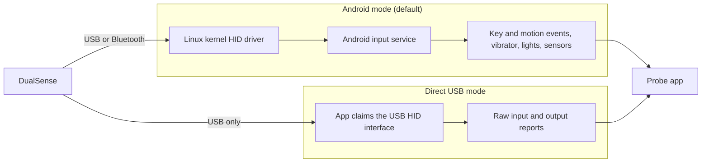
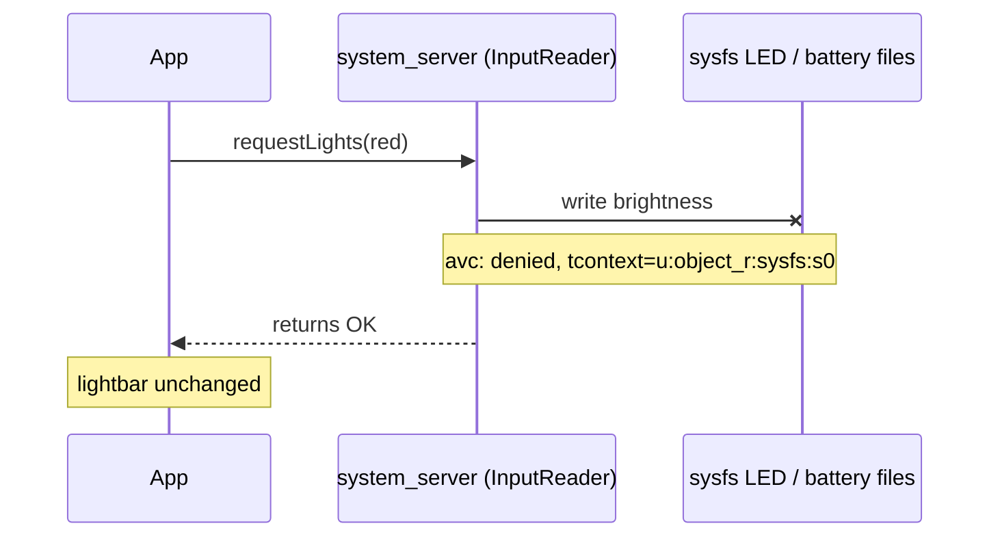
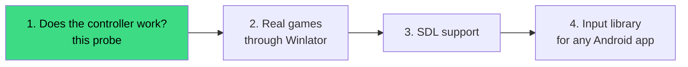

# DualSense-Probe-Android

A `joy.cpl` for the PS5 DualSense on Android. Press anything and watch it light up, fire every output by hand, and see **exactly which features Android passes through and which only work if an app talks to the controller itself.**

   

## Two routes to the same controller



| | Android mode | Direct USB mode |
|---|---|---|
| What it shows | What an ordinary Android game gets today | What an app with its own driver can get |
| How | Only Android's public controller APIs | Takes the pad from the kernel, reads and writes raw reports |
| Transport | USB and Bluetooth | USB |
| Leaving | Nothing to undo | Sends "everything off", hands the pad back to Android |

## What works where

Tested on a Pixel 11 Pro XL, Android 17 (`CD1A.261005.003`).

✅ works, seen or felt on the pad · ⚠️ half works · ❌ not available

| Feature | Android, USB | Android, Bluetooth | Direct USB |
|---|:-:|:-:|:-:|
| Face buttons, L1/R1, L2/R2 click, L3/R3, Create, Options, PS | ✅ | ✅ | ✅ |
| D-pad, sticks, analog triggers | ✅ | ✅ | ✅ |
| Mute button | ❌ | ❌ | ✅ |
| Touchpad | ⚠️ one finger, relative only | ⚠️ one finger, relative only | ✅ two fingers, absolute X/Y |
| Gyroscope, accelerometer | ✅ | ✅ | ✅ |
| Headphone jack detection | ❌ | ❌ | ✅ |
| Battery | ❌ no reading | ✅ | ⚠️ raw value read, percent mapping unconfirmed |
| Rumble, left and right | ⚠️ weak, one feel | ⚠️ weak, one feel | ✅ |
| Lightbar | ❌ call succeeds, nothing lights | ✅ | ✅ |
| Player LEDs | ❌ call succeeds, nothing lights | ✅ | ✅ |
| Mute LED | ❌ | ❌ | ✅ |
| Adaptive triggers | ❌ | ❌ | ✅ |
| Speaker, headphone out, HD haptics | ❌ | ❌ | ✅ |
| Microphone | ✅ | ❌ | ✅ |

## Found along the way: Android can't light the controller over USB

Over USB, `requestLights()` and `getBatteryState()` return normally and do nothing. Bluetooth works; Direct USB works. The cause is an SELinux denial:



<details>
<summary>Log lines and how to reproduce</summary>

```
E EventHub: Can not write to file, error: Permission denied
E EventHub: Failed to read sysfs battery info: Permission denied
avc: denied { read } for comm="InputReader" name="max_brightness" dev="sysfs"
     scontext=u:r:system_server:s0 tcontext=u:object_r:sysfs:s0 tclass=file permissive=0 bug=b/458240870
avc: denied { read } for comm="binder:1771_1F" name="brightness" dev="sysfs"
     scontext=u:r:system_server:s0 tcontext=u:object_r:sysfs:s0 tclass=file permissive=0 bug=b/458240870
```

1. Plug a DualSense into the phone by USB.
2. From any app, open a lights session on the controller's `InputDevice` and request a colour for the light named `indicator`.
3. `adb logcat -b all | grep -E "EventHub|avc.*system_server.*sysfs"` shows the errors above; the lightbar stays as it was.
4. Pair the same controller over Bluetooth and repeat: the lightbar changes.

The `b/458240870` tag is a catch-all the phone stamps on every `system_server` denial against a plain `sysfs` file, not a report of this problem. `dumpsys input` shows every raw light at brightness -1 over USB, and real values over Bluetooth.

</details>

## Screens

| Screen | What it does |
|---|---|
| Live | Every input drawn on a controller: buttons light, stick dots move, trigger bars climb 0-255, touch points follow your finger |
| Outputs | Rumble, lightbar colour picker, player LEDs, mute LED, trigger resistance; anything the route can't reach is greyed with the reason |
| Debug Mode | "Run All Tests and Generate Log": a guided tour of every feature on both routes, plus a live route trace naming the exact byte, bit or API call behind each event. The log is plain text, scrubbed of Bluetooth addresses, ready for a bug report |

## Code

| Module | What's in it |
|---|---|
| `pad/` | Plain Kotlin, no Android: parses input reports, builds output reports. Tested on the JVM against reports captured from a real pad and golden output bytes |
| `app/` | Jetpack Compose app: the two routes, live screens, outputs, Debug Mode |

```sh
./gradlew test             # pad and app unit tests
./gradlew assembleDebug    # APK in app/build/outputs/apk/debug/
./lint.sh                  # ktlint + detekt, any finding fails
```

Needs JDK 17 and the Android SDK (`compileSdk 35`, `minSdk 31`).

## Where this is going



## Licence

MIT.
